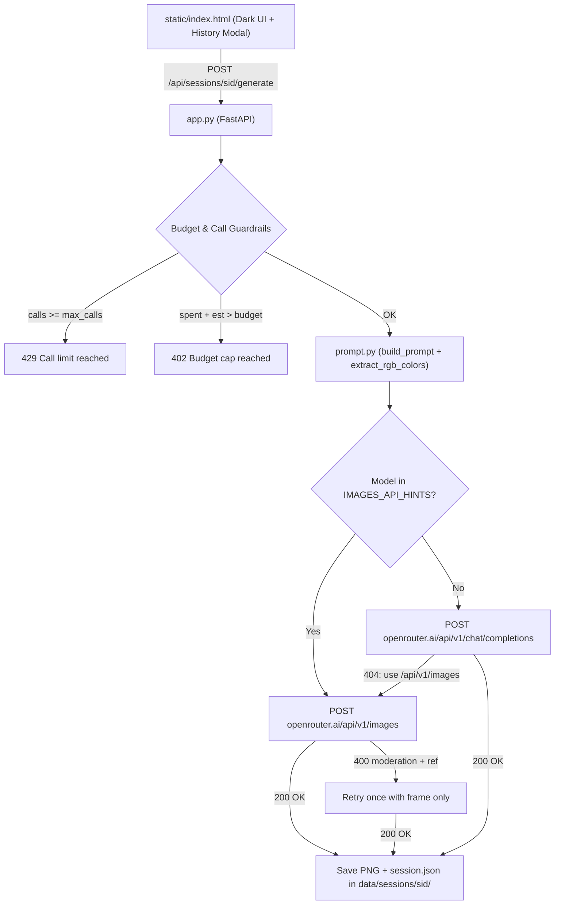
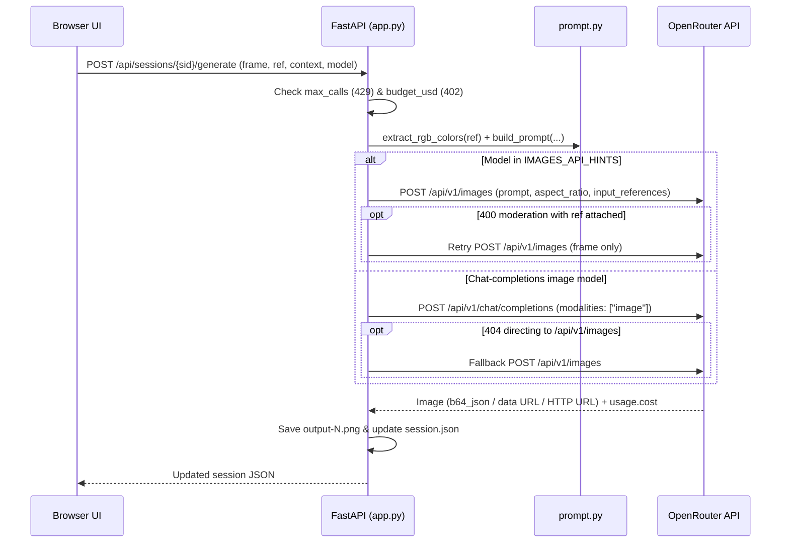

# imggen

Minimal black-and-white thumbnail generation studio powered by **FastAPI**, **OpenRouter**, and a single-file vanilla JS UI (`static/index.html`), with strict pre-call budget/call-count guardrails, multi-model dropdown selection, IP-agnostic template extraction, and a cross-session Generation History & Model Cost dashboard.

---

## Architecture



### Request Sequence



---

## Setup & Run

Requires **Python >= 3.11** and [`uv`](https://docs.astral.sh/uv/).

```bash
cp .env.example .env   # add OPENROUTER_API_KEY and optional defaults
uv sync
uv run uvicorn app:app --port 8400
```

Open `http://127.0.0.1:8400`:
1. Attach **Frame Image** (subject/presenter) and **Reference Image** (layout blueprint).
2. Paste **Video Context** and optional **Instruction**.
3. Pick a model from the dropdown and **Aspect Ratio**, then click **Generate**.
4. Click **History** in the header to view total spend, per-model average/total costs, filterable output gallery, and resume any past session.

---

## Configuration (`.env`)

| Variable | Default | Description |
| :--- | :--- | :--- |
| `OPENROUTER_API_KEY` | `""` | Required OpenRouter API key |
| `IMAGE_MODEL` | `recraft/recraft-v4.1-flash-v2` | Default model selected on startup |
| `ESTIMATED_COST_PER_IMAGE` | `0.007` | Pre-call budget check & fallback cost when `usage.cost` is absent |
| `BUDGET_USD` | `0.10` | Per-session hard spend cap (`spent + est <= BUDGET_USD`) |
| `MAX_CALLS` | `10` | Per-session hard call limit |
| `DATA_DIR` | `./data` | Directory where `sessions/<sid>/` artifacts are stored |

---

## API Endpoints

| Method & Path | Purpose |
| :--- | :--- |
| `GET /` | Serves `static/index.html` |
| `GET /api/config` | Returns default model, `IMAGE_MODELS` list, budget/call caps, key status, and aspect ratios |
| `POST /api/sessions` | Creates a new session under `data/sessions/<sid>/` |
| `GET /api/sessions/{sid}` | Returns session state with computed `spent_usd` and `calls_used` |
| `POST /api/sessions/{sid}/generate` | Validates caps, builds prompt, calls OpenRouter, saves PNG, updates session |
| `GET /api/history` | Aggregates `totals`, `by_model` costs, and newest-first `items` across all sessions |
| `GET /api/sessions/{sid}/outputs/{name}` | Serves generated PNG (`?download=1` for attachment) |
| `GET /api/sessions/{sid}/inputs/{name}` | Serves uploaded `frame.png` or `ref.png` |

---

## Tests

All tests mock `httpx.post` and isolate `DATA_DIR` in a temporary directory (zero live API spend):

```bash
uv run pytest -q
```
